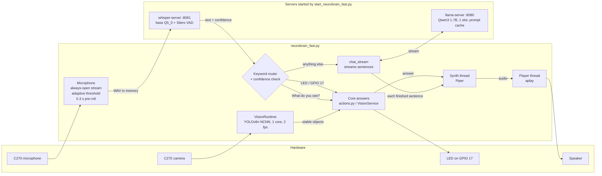
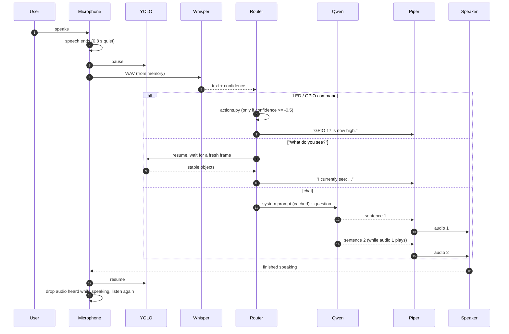
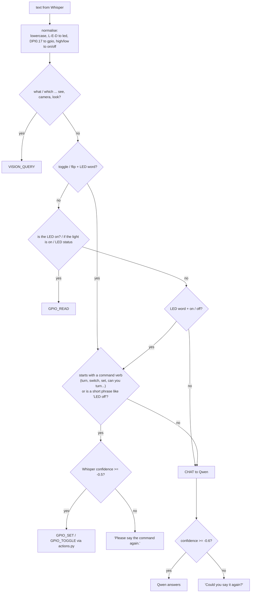

# NeuroBrain Fast

**Branch:** `neurobrain-fast`
**Entry point:** `start_neurobrain_fast.py` → `neurobrain_fast.py` + `vision_runtime_fast.py`
**Original version (unchanged):** `start_neurobrain_vision_dev.py` → `neurobrain_vision_dev.py` + `vision_runtime.py`

NeuroBrain Fast does the same job as the original voice + vision + GPIO system: same hardware, same
Qwen3 1.7B model and the same safety boundary. It reorganises *when* each part runs, so that the Raspberry
Pi 4's four cores are used for one job at a time. Known commands skip the LLM entirely.

---

## 1. Running it

### Commands

| Command | Starts |
|---|---|
| `neurobrain` | the fast version (this branch) |
| `neurobrain-fast` | the fast version (same as above) |
| `neurobrain-legacy` | the original version, unchanged |

Stop with **Ctrl+C**. The Qwen and Whisper servers are stopped with it.

The commands are small scripts in `~/.local/bin`, which comes before `/usr/local/bin` in `PATH`
(the old `/usr/local/bin/neurobrain` is left as it was). Copies live in [`bin/`](../bin):

```bash
cp ~/neurobrain/bin/neurobrain ~/neurobrain/bin/neurobrain-fast ~/neurobrain/bin/neurobrain-legacy ~/.local/bin/
chmod +x ~/.local/bin/neurobrain*
```

Or start it directly:

```bash
/home/drpeker/neurobrain/venv/bin/python /home/drpeker/neurobrain/start_neurobrain_fast.py
```

### One-time setup on a fresh install

1. **Whisper base Q5_0** is made locally from `ggml-base.bin` (no download):
   ```bash
   cd ~/whisper.cpp/models
   ../build/bin/whisper-quantize ggml-base.bin ggml-base-q5_0.bin q5_0
   ```
2. **lgpio for gpiozero.** `pip install lgpio` cannot build on the Pi, but Raspberry Pi OS ships
   `python3-lgpio` for the same Python 3.13 as the venv. Link it into the venv:
   ```bash
   SP=$(~/neurobrain/venv/bin/python -c "import site; print(site.getsitepackages()[0])")
   ln -sf /usr/lib/python3/dist-packages/lgpio.py "$SP/lgpio.py"
   ln -sf /usr/lib/python3/dist-packages/_lgpio.cpython-313-aarch64-linux-gnu.so "$SP/"
   ```
   Without it gpiozero still works, but falls back to its experimental `NativeFactory`.
3. The C270 webcam must be plugged in: it is both the camera and the microphone. A loose USB
   cable makes it disappear from `lsusb` (kernel log: `Maybe the USB cable is bad?`).

### What the start screen shows

```text
==================================================
            NeuroBrain (fast) starting
==================================================
  LLM        : Qwen3 1.7B (Q4_K_M), 1.28 GB
               qwen3-1.7b-q4km.gguf
               llama.cpp, 4 threads, context 2048, reasoning off, port 8080
  Speech in  : Whisper base (Q5_0), English, greedy, 10 s window + Silero VAD, port 8081
  Speech out : Piper en_US-lessac-medium
  Vision     : YOLOv8n (NCNN), 1 core, 2 fps, paused while NeuroBrain answers
--------------------------------------------------
Hardware check
  Microphone : C270 HD WEBCAM: USB Audio (hw:1,0)
  Camera     : /dev/video0
...
=== NeuroBrain (fast) ===
  TTS     : Piper en_US-lessac-medium.onnx (5.3 s)
  Mic     : C270, always open, 0.3 s pre-roll, noise 0.040 -> start 0.060 / stop 0.048 RMS
  STT     : Whisper server ready, port 8081 (6.9 s after start)
  LLM     : qwen3-1.7b-q4km.gguf ready, port 8080 (6.9 s after start)
  Prompt  : loading system prompt into the LLM cache... done (6.0 s)
  Memory  : off (every question is answered on its own)
  Router  : LED / GPIO 17 and 'What do you see?' answered without the LLM
System ready (12.9 s).
```

Each spoken turn then prints what was heard, how sure Whisper was, where it was routed and how long
each step took:

```text
👤 Tell me the capital city of Finland.  [Whisper 3.85 s, audio 2.4 s, confidence -0.13]
🧭 {'action': 'CHAT'}
🤖 The capital city of Finland is Helsinki.  [LLM first sentence 4.64 s, total 4.64 s]
```

If the C270 is missing, it stops before loading any model and says so. Logs of the two servers:
`/tmp/neurobrain-qwen.log` and `/tmp/neurobrain-whisper.log`.

---

## 2. How it works

### Components



### One conversation turn

The LLM streams its answer. As soon as a sentence is complete it goes to Piper, and while the speaker
plays it, Piper is already preparing the next sentence and Qwen is still writing the one after.



### Who uses the CPU when

YOLO used to run non-stop on all four cores. Every other model had to share them, and Qwen produced
1.4 tokens/s instead of 3.1. Now YOLO only works while NeuroBrain is waiting for someone to talk.

```mermaid
gantt
    title CPU use during one chat turn (4 cores)
    dateFormat X
    axisFormat %s s
    section Microphone
    listening, YOLO 1 core at 2 fps   :done, 0, 3
    section Whisper (4 threads)
    transcribe                        :active, 3, 7
    section Qwen (4 threads)
    first sentence                    :crit, 7, 11
    rest of the answer                :crit, 11, 16
    section Piper + speaker
    speak sentence 1                  :12, 15
    speak sentence 2                  :16, 19
    section YOLO
    running                           :done, 0, 3
    paused                            :3, 19
    running again                     :done, 19, 22
```



### Startup in parallel

```mermaid
gantt
    title Startup (about 13-16 s)
    dateFormat X
    axisFormat %s s
    section start_neurobrain_fast.py
    hardware check                       :0, 1
    Qwen server loads the model          :1, 7
    Whisper server loads the model       :1, 7
    section neurobrain_fast.py
    load Piper voice                     :1, 6
    open microphone, measure room noise  :6, 7
    load YOLO, open camera               :6, 8
    put system prompt into the LLM cache :8, 14
```



The original version did these steps one after another and loaded Piper only after both servers were
ready.

### Keyword router

Known commands are recognised from words instead of asking Qwen. The old Qwen router call took
5–45 s per request. The router accepts common Whisper spellings (`L-E-D`, `DPI0.17`, `GPI 17`,
`CPIO`, "high" and "low").



The command-verb rule keeps questions such as "How do I turn on an LED with Arduino?" or
"Tell me the capital city of Finland." away from the hardware. The safety boundary is unchanged:
the LLM never switches anything, and only `actions.py` → `hardware.py` touch GPIO 17.

---

## 3. What changed compared with the original

### Measured results

Measured on the Pi 4 (4 GB, no fan, 42–62 °C, no throttling during the tests). The voice tests use
the real program: Piper-spoken questions played through the speaker and heard by the C270 microphone.

| | Original | Fast |
|---|---|---|
| LED / GPIO and "What do you see?" | Whisper + Qwen router call (5–45 s) | Whisper only, then instant |
| Chat, time to first spoken words | Qwen router + full answer, then speech (9–47 s) | first sentence after 3.2–5 s typically (up to ~13 s for long answers) |
| Qwen generation speed | 1.4 tokens/s (YOLO competing) | 3.1 tokens/s |
| Qwen calls per question | 2 (router + answer), each reading its own system prompt | 1; system prompt cached, 12–17 new tokens read (1.5–2 s) |
| Whisper per question | 5.3 s (tiny, beam 3, 30 s window) | 3.7 s (base Q5_0, greedy, 10 s window) |
| Whisper word accuracy (10 questions) | 75 % | 78–88 % per run |
| YOLO CPU while idle | 114 % of a core | 44 % of a core |
| YOLO output decoding per frame | 45 ms (Python loop) | 1 ms (numpy) |
| Gap between spoken sentences | ~1 s (synthesis, then playback) | none (synthesis overlaps playback) |
| Startup | servers, then Piper, one after another | 13–16 s, in parallel |

### Changes, one by one

**Speech in**
- **Whisper base Q5_0** instead of tiny Q4_0. Tested in the running app: tiny Q4_0 80 % / 1.9 s, base
  Q5_0 78–88 % / 3.7 s with every LED command right in one run, base f16 89 % / 6.4 s,
  base Q4_0 67 %. Base Q5_0 is the best balance. Switching back to tiny is one line
  (`WHISPER_MODEL` in `start_neurobrain_fast.py`).
- **Greedy decoding and a 10 s window** (`-bs 1 -bo 1 -ac 512`). Beam search and the 30 s window
  cost 3x the time for no accuracy gain (75 % vs 80 % on tiny).
- **No Whisper prompt.** A prompt listing the commands made Whisper turn unclear speech into those
  commands: "Tell me the capital city of Finland" came out as "set GPIO 17 high". It also made
  Whisper repeat the prompt in a loop, taking 6–11 s.
- **Confidence check.** Whisper's `avg_logprob` is read for every request. LED switching needs
  ≥ -0.5 and chat needs ≥ -0.6; otherwise NeuroBrain asks again rather than act on a guess.
- **Repeated sentences removed** ("Is it on? Is it on? Is it on?" becomes one sentence).

**Microphone**
- **Always-open stream** instead of reopening ALSA for every question. Audio heard while NeuroBrain
  was speaking is dropped before listening again, so it does not hear itself.
- **0.3 s pre-roll**: the moment before the level crosses the threshold is kept, so first syllables
  are not cut.
- **Adaptive threshold.** The C270 hears 0.024–0.04 RMS of background noise, peaking above the old
  fixed 0.03 threshold, so silence was taken for speech and recordings ran for 8 s. The noise floor
  is measured at startup and tracked while nobody speaks. A recording starts at 2x the noise
  (between 0.03 and 0.06) and stops below 1.5x.
- **8 s limit** per recording, matching the 10 s Whisper window.
- **No temp files and no `curl` process.** Audio goes to Whisper from memory.

**Thinking**
- **Keyword router** for LED / GPIO 17 and vision (see diagram). There is no Qwen router call.
- **One Qwen slot and a cached system prompt.** The prompt is read once at startup, so later questions only
  read their own words.
- **Streaming.** The answer is spoken sentence by sentence while Qwen is still writing.
- **Token-limit cut.** When an answer reaches 60 tokens in the middle of a sentence, the unfinished
  fragment is not spoken.
- **Short system prompt.** It only gives the name and asks for short English answers.
- **Chat memory is available but off** (`MEMORY_TURNS = 0`). With memory on, llama.cpp could not
  reuse the cache for earlier answers. Every question re-read 45–60 tokens (+5–7 s), and one
  misheard answer carried over into the next ones. When enabled, memory is cleared instead of
  trimmed, so the cache stays valid.

**Speech out**
- **Two threads:** Piper synthesises the next sentence while `aplay` plays the current one. Audio is
  streamed to `aplay` as raw PCM; nothing is written to disk.

**Vision**
- **YOLO on one core, at most 2 fps**, paused from the end of a recording until the answer has been spoken.
  For "What do you see?" it is resumed and NeuroBrain waits for a fresh frame (≤ 1 s old).
- **Vectorised YOLOv8 decoding** with numpy: identical boxes (checked on 1,068 detections), 45 ms → 1 ms.

**Robustness and messages**
- Hardware check before startup; clear message instead of a traceback when the C270 is missing.
- Clean shutdown on Ctrl+C (camera released, servers stopped once).
- All console messages and code comments in English; gpiozero fallback warnings hidden.

---

## 4. Files

| File | Role |
|---|---|
| `start_neurobrain_fast.py` | Start screen, hardware check, starts Qwen + Whisper servers and the voice loop, stops everything on exit |
| `neurobrain_fast.py` | Voice loop: microphone, Whisper client, keyword router, Qwen streaming, Piper threads |
| `vision_runtime_fast.py` | Background YOLOv8n/NCNN loop with pause/resume and numpy decoding |
| `actions.py`, `hardware.py` | Unchanged safety boundary for GPIO 17 |
| `vision_state.py`, `vision_service.py` | Unchanged object stabilisation and thread-safe state |
| `bin/neurobrain*` | Launcher scripts for `~/.local/bin` |

---

## 5. Limits and next steps

- **Qwen3 1.7B is the main remaining wait** (~3 tokens/s on the Cortex-A72). Larger gains need a Pi 5
  (roughly 2–3x faster), shorter answers, or a smaller model. Qwen3 0.6B is 2.5–3x faster but gave
  wrong facts in tests ("the sky is blue because of water droplets").
- **Qwen3 Q4_0** was tested for KleidiAI acceleration: only about 6 % faster on the Pi 4, because the Cortex-A72 lacks the
  required instructions. It may help on a Pi 5.
- **Whisper on a small model still mishears**, especially "LED". The confidence check prevents
  wrong actions, but the user may have to repeat a command.
- **Small models still invent facts** about unclear input. The chat confidence check filters the
  worst cases.
- **Cooling:** without a fan the Pi reached its soft temperature limit once (`vcgencmd get_throttled`
  = `0x80000`). A fan or heatsink keeps it at full speed during long sessions.
